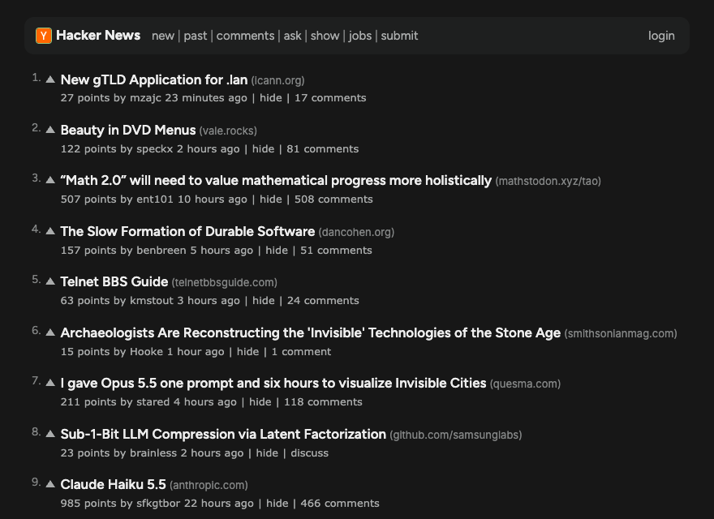

# Darker News

Darker News is a Chrome extension that restyles [Hacker News](https://news.ycombinator.com) for
easier reading. It uses the dark-mode colors of the Buffer app, the Inter and Figtree fonts, and
bigger text.



## What it changes

- **Colors:** a near-black background, light gray text, and a green accent for links, buttons,
  and focus outlines.
- **Fonts:** Figtree for the header and story titles. Inter for all other text. The extension
  includes both fonts, so it makes no network requests.
- **Sizes:** story titles are 17px. Comments are 16px with more space between lines.
- **Layout:** the page is a centered column, at most 820px wide.
- **Comments:** a line on the left of each comment shows its nesting level. The `[–]` toggle is
  bigger and easier to click.
- **Phones:** the pages fit a 390px screen with no sideways scroll.

The extension is CSS only. It runs no scripts and asks for no permissions. Every HN feature, such
as voting, replies, and login, works as before.

## Install

The extension is not in the Chrome Web Store. Load it from this repository:

1. Clone this repository.
2. Open `chrome://extensions` in Chrome.
3. Turn on **Developer mode**.
4. Click **Load unpacked**, then select the `extension/` folder. Do not select the repository root.
5. Open https://news.ycombinator.com.

After you change the CSS, click the reload button on the extension card. Then reload the HN tab.

## Project layout

```
extension/manifest.json           Manifest V3, one content script
extension/styles/darker-news.css  the theme
extension/fonts/                  Inter and Figtree, with their licence files
extension/icons/                  the icon source and PNG sizes
tests/                            Playwright tests and saved HN pages
scripts/make-icons.ts             renders the icon to PNG
```

All colors are custom properties on `:root`, at the top of `darker-news.css`. To change the
palette, change those values only.

## Develop

You need Node 22.18 or later.

```bash
npm install
npx playwright install chromium
npm test                       # style checks against saved HN pages
npm run typecheck
npm run screenshots            # images of the saved pages, in screenshots/
DN_LIVE=1 npm run screenshots  # images of the live site
npm run icons                  # renders extension/icons/icon.svg to PNG
```

The tests load the extension in Chromium. They serve saved copies of HN pages, so they run
offline and see the same markup each time. To update the saved pages, run:

```bash
curl -sSfL https://news.ycombinator.com/news -o tests/fixtures/news.html
curl -sSfL 'https://news.ycombinator.com/item?id=50002008' -o tests/fixtures/item.html
curl -sSfL 'https://news.ycombinator.com/user?id=dang' -o tests/fixtures/user.html
curl -sSfL https://news.ycombinator.com/login -o tests/fixtures/login.html
curl -sSfL https://news.ycombinator.com/news.css -o tests/fixtures/news.css
```

The comment tests need an item page with deep threads and a code block. If you change the item
id, change it in the tests too.

## Limits

HN uses tables with few class names, so some rules target the table structure. If HN changes its
HTML, those rules can stop working. The page then looks plain, but it still works.

## Fonts

Inter and Figtree use the SIL Open Font License 1.1. The licence files are in `extension/fonts/`.
