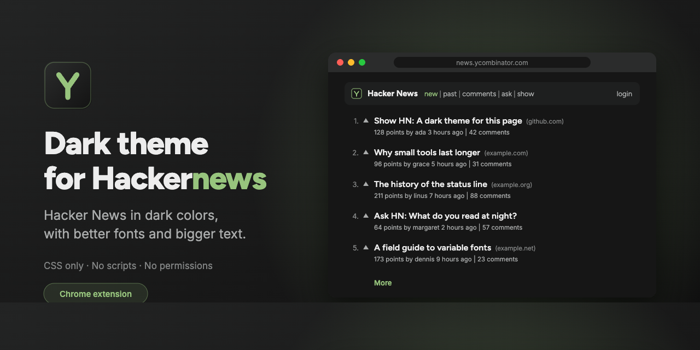

# Dark theme for Hackernews



A Chrome extension. It restyles [Hacker News](https://news.ycombinator.com) for easier reading. It uses the dark-mode colors of the Buffer app, the Inter and Figtree fonts, and bigger text.


## What it changes

- **Colors:** a near-black background, light gray text, and a green accent for links, buttons, and focus outlines.
- **Fonts:** Figtree for the header and story titles. Inter for all other text. The extension includes both fonts, so it makes no network requests.
- **Sizes:** story titles are 17px. Comments are 16px with more space between lines.
- **Layout:** the page is a centered column, at most 820px wide.
- **Comments:** a line on the left of each comment shows its nesting level. The `[–]` toggle is bigger and easier to click.
- **Phones:** the pages fit a 390px screen with no sideways scroll.

The extension is CSS only. It runs no scripts, collects no data, and asks for no permissions. `PRIVACY.md` has the details. Every HN feature, such as voting, replies, and login, works as before.

## Install

The extension is not in the Chrome Web Store yet. Each [GitHub release](https://github.com/brunojppb/darker-news-theme/releases) has the extension as a zip file. To build it from this repository, see the next section.

Chrome 111 or newer is needed.

## Develop

[mise](https://mise.jdx.dev) installs the Node and pnpm versions that `mise.toml` pins. [Vite+](https://viteplus.dev) (`vp`) builds the stylesheet and checks the TypeScript sources.

```
mise install
pnpm install
pnpm exec playwright install chromium
pnpm build
```

`pnpm build` writes the extension to `dist/extension/`. To run your local copy:

1. Open `chrome://extensions`.
2. Turn on Developer mode.
3. Click Load unpacked and pick the `dist/extension/` folder.
4. Open https://news.ycombinator.com.

After a change, run `pnpm build` again, click the reload button on the extension card, and reload the HN tab.

The other scripts:

```
pnpm check
pnpm e2e
pnpm screenshots
pnpm icons
pnpm package
pnpm store:assets
```

- `pnpm check` formats, lints, and type-checks the code with `vp check`.
- `pnpm e2e` builds the extension and loads it in Chromium on saved copies of HN pages.
- `pnpm screenshots` saves desktop and phone images of the saved pages to `screenshots/`. `DN_LIVE=1 pnpm screenshots` uses the live site.
- `pnpm icons` renders the icon SVGs in `docs/assets/` to the PNG files in `public/icons/`.
- `pnpm package` builds `dist/darker-news-v<version>.zip`, the file for the Chrome Web Store. It fails if the zip holds a file that does not belong.
- `pnpm store:assets` builds the store screenshots and promo tile in `store/`, and the README banner.

CI runs `check`, `package`, and `e2e` on every pull request, and checks that the manifest version matches `package.json`. Every dependency has an exact version, and every GitHub Action has a commit SHA.

## Project layout

```
src/darker-news.css    the theme
src/fonts/             Inter and Figtree
public/manifest.json   Manifest V3, one content stylesheet
public/icons/          the icon PNG sizes
public/fonts/          the font licence files
docs/assets/           the icon and banner sources
store/                 the Chrome Web Store text and images
test/e2e/              Playwright tests and saved HN pages
scripts/               the icon, package, and store image scripts
```

All colors are custom properties on `:root`, at the top of `src/darker-news.css`. To change the palette, change those values only.

The stylesheet names each font by a relative path. The build changes each path to a `chrome-extension://` URL, because Chrome resolves a relative URL in a content stylesheet against the HN page.

## Tests

The tests serve saved copies of HN pages, so they run offline and see the same markup each time. To update the saved pages, run:

```bash
curl -sSfL https://news.ycombinator.com/news -o test/e2e/fixtures/news.html
curl -sSfL 'https://news.ycombinator.com/item?id=50002008' -o test/e2e/fixtures/item.html
curl -sSfL 'https://news.ycombinator.com/user?id=dang' -o test/e2e/fixtures/user.html
curl -sSfL https://news.ycombinator.com/login -o test/e2e/fixtures/login.html
curl -sSfL https://news.ycombinator.com/news.css -o test/e2e/fixtures/news.css
```

The comment tests need an item page with deep threads and a code block. If you change the item id, change it in the tests and in `scripts/store-assets.ts` too. The store screenshots show these pages, so read the new screenshots before you publish them.

## Release

Add a changeset to each pull request that changes the extension: run `pnpm changeset`, pick the bump, and describe the change. After a merge to `main`, the Release workflow opens a "chore: version packages" pull request. A merge of that pull request bumps the version in `package.json` and `public/manifest.json`, updates `CHANGELOG.md`, pushes a `vX.Y.Z` tag, and creates a GitHub release. The release holds the extension as a zip file.

`store/listing.md` holds the Chrome Web Store listing text and the answers for the privacy tab.

## Limits

HN uses tables with few class names, so some rules target the table structure. If HN changes its HTML, those rules can stop working. The page then looks plain, but it still works.

## License

MIT. See `LICENSE`. Inter and Figtree use the SIL Open Font License 1.1. The licence files are in `public/fonts/`.

This project is not affiliated with Hacker News or Y Combinator.
